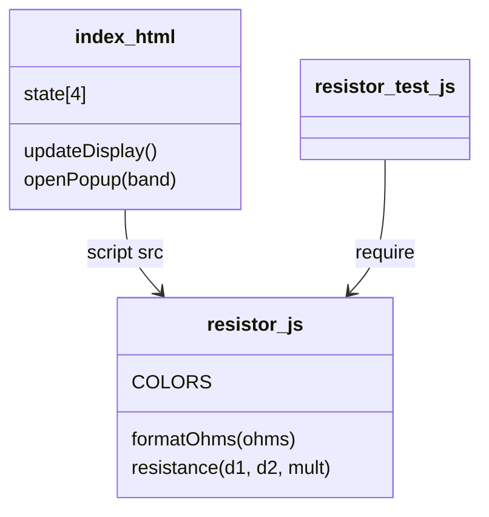

# Notes

## Value formatting
`formatOhms` scales to the largest unit and prints 3 significant digits. Trailing
zeros must only be stripped after a decimal point. The original regex
`/\.?0+$/` also ate integer zeros, so 220 rendered as "22" and 100 kOhm as "1 kOhm".

## Layout
Pure math (`COLORS`, `formatOhms`, `resistance`) lives in `resistor.js` so it can
be unit tested with `bun test`; `index.html` holds the UI.

